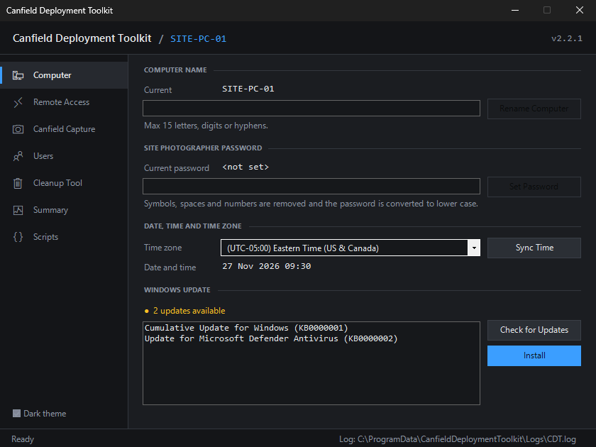
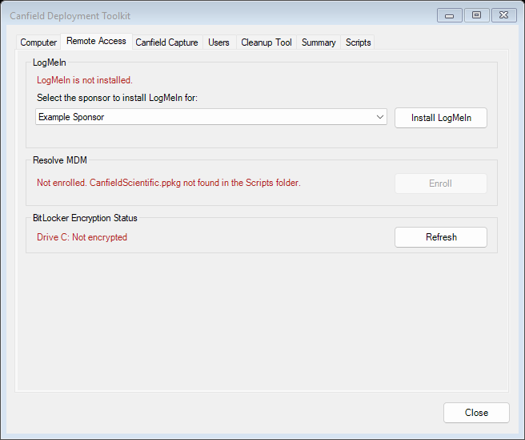
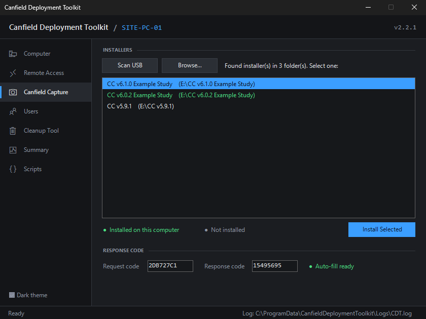
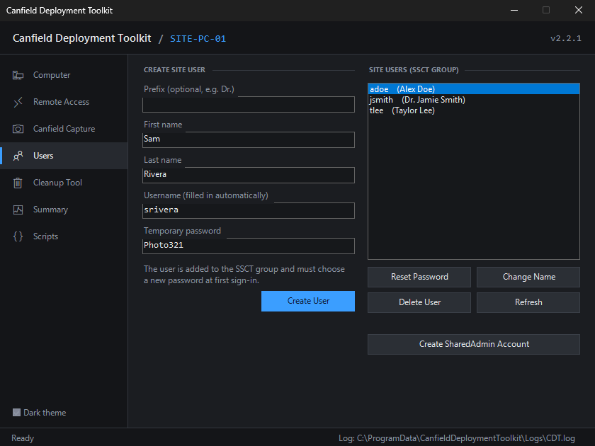
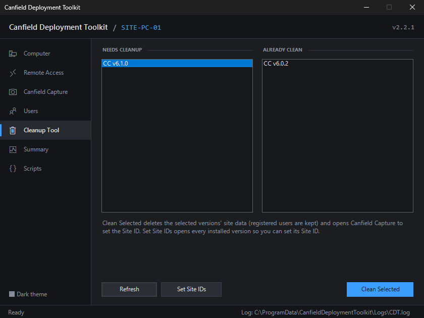
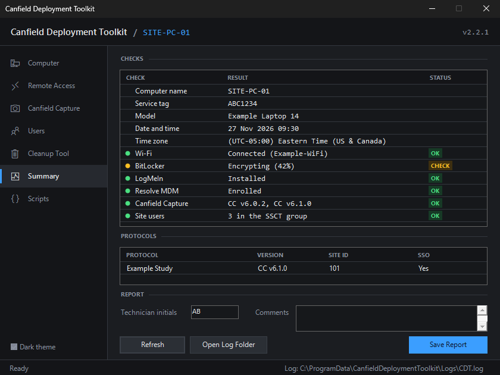
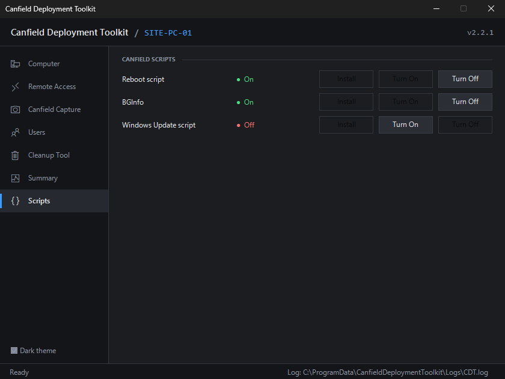

# Canfield Deployment Toolkit: User Guide

The Canfield Deployment Toolkit (`CDT.exe`) gathers the steps for setting up a
clinical study site computer into one window. Each page handles one part of
the job. This guide explains what each page is for and how to use it.

## Before You Start

Have these ready:

- A USB drive with the Canfield Capture installer folders (each with a `setup.exe`).
- The sponsor list for LogMeIn: a `sponsors.csv` next to `CDT.exe`. A
  `CDT.exe` built on your own computer can have the list built in (the build
  asks for the file); downloaded releases do not.
- The `Scripts` folder next to `CDT.exe`, for the Canfield scripts and Resolve MDM.
- A network connection (LogMeIn is downloaded during install).

Double-click `CDT.exe` and click **Yes** if Windows asks for administrator
rights.

### The Window

- **Header**: the app name, this computer's name and, on the right, the
  toolkit version (for example `v2.2.1`, or `v2.2.1+5` for a build made 5
  changes after that release).
- **Sidebar**: pick a page on the left. **Dark theme** at the bottom
  switches to dark colors (as in the pictures below); the toolkit remembers
  the choice the next time it opens.
- **Status bar**: shows what the toolkit is doing (or **Ready**) and where
  its log file is.

Pressing **Enter** in a text box clicks the button next to it (for example
**Rename Computer**). There is no Close button: close the toolkit with the
**X** in the title bar or press **Esc**.

## Computer

Basic computer settings.

- **Rename Computer**: type the new name (up to 15 letters, digits or
  hyphens) and click **Rename Computer**. Until you restart, **Current**
  shows the old and new name with a **RESTART PENDING** tag. The toolkit
  offers to restart, which is needed for the new name to take effect.
- **Site Photographer password**: the label shows the current password, or
  `<not set>` if the toolkit has not set one. Type the new password and click
  **Set Password**. Symbols, spaces and numbers are removed and letters are
  made lower case. The password never expires.
- **Time zone**: pick the site's time zone from the list. It applies right
  away, and the date and time show below it. Click **Sync Time** to set the
  clock from the internet time server.
- **Windows Update**: click **Check for Updates**. The check runs in the
  background and can take a few minutes, with a running timer. It then shows **Up to date** in
  green, or how many updates are available in amber, with their names
  listed below. Click **Install** to install them; this can take a while.
  When it finishes, the list shows which updates installed, failed or were
  skipped, and it asks to restart if Windows needs it.

## Remote Access

Sets up remote support.

- **LogMeIn**: choose the study sponsor and click **Install LogMeIn**. The
  toolkit downloads and installs LogMeIn into that sponsor's account. The
  status line shows whether LogMeIn is installed, and if it is, the toolkit
  asks before reinstalling.
- **Resolve MDM**: click **Enroll** to enroll the computer in device
  management. The status line shows whether it is already enrolled.
  Enrolling needs `CanfieldScientific.ppkg` in the `Scripts` folder.
- **BitLocker encryption status**: shows whether the system drive is
  encrypted. Green means encrypted, amber means encrypting or decrypting
  (with the percentage, which updates every 10 seconds), and red means not
  encrypted, protection off, or no recovery key. Click **Refresh** to check
  again.

## Canfield Capture

Installs Canfield Capture and provides a PowerShell implementation of the Response Code Generator
for registering users.

1. Insert the USB drive. The toolkit scans it the first time you open the
   page. Click **Scan USB** to scan again. If the installer is somewhere
   else (another folder, a network share) or the scan finds nothing, click
   **Browse...** and pick its `setup.exe`.
2. Pick an installer from the list. Versions already installed on this
   computer show in **green**; versions not yet installed show in the normal
   text color. The legend under the list says the same.
3. Click **Install Selected**. The installer runs silently and the toolkit
   reports when it is done or if a restart is needed.

**Request / Response Codes.** The toolkit calculates the response code from
the request code exactly as ResponseCodeGenerator.exe does, so RCG is
no longer required. Make sure the toolkit is open when registering users and
the request/response codes will populate automatically just like RCG.
There is a status indicator next to the **Response code:** field that indicates
whether auto-fill is functioning properly.

## Users

Manages the Windows accounts that site staff sign in with. This page won't be
used much as we move to SSO.

- **Create site user**: enter first and last name (and a prefix if
  needed). The username fills in automatically and can be edited. The
  temporary password is `Photo321`; the user must choose a new one at first
  sign-in. New users are added to the `SSCT` group.
- If every installed protocol uses single sign-on (SSO), a red note under
  **Create User** says so, since local users are usually not needed. The
  toolkit asks before creating one anyway.
- The list shows the users in the `SSCT` group. Select a user to **Reset Password**, **Change Name** or
  **Delete User**. Built-in accounts (Site Photographer, SharedAdmin,
  Administrator, and the signed-in account) cannot be deleted.
- **Create SharedAdmin Account** asks for a password and creates the shared
  administrator account. It is greyed out once the account exists.

## Cleanup Tool

Removes leftover Canfield Capture data to prep for shipment.

- Versions that still have site data are listed under **Needs cleanup** and
  are already ticked. Click **Clean Selected** and confirm.
- After cleaning, Canfield Capture opens for each cleaned version. Set the
  Site ID, then close Capture to move on to the next one.
- Finally, all site users are set to change their password at next sign-in.
- **Set Site IDs** opens every installed version in turn, so you can set the
  Site ID without cleaning.

Registered users are always kept.

## Summary

A final check of the whole setup, and the QC report.

1. Review the **Checks** list: computer name, service tag, model, date and
   time, time zone, Wi-Fi, BitLocker, LogMeIn, Resolve MDM, Canfield
   Capture versions and site users. Each status has a tag: **OK** (green),
   **CHECK** (amber, worth a look) or **ACTION** (red, needs fixing). Under
   **Protocols**, each installed protocol shows its version, Site ID and
   whether it uses SSO. The page checks again each time you open it; click
   **Refresh** to check again yourself.
2. Enter your initials and any comments.
3. Click **Save Report** and pick where to save it. It saves a picture of
   the window (JPG), a text file with the same details and a copy of the
   toolkit log, all with the same name.

**Open Log Folder** opens the folder holding `CDT.log`, the toolkit's log of
everything it did on this computer. Send it along with the QC report if
something went wrong. Passwords are never written to the log.

## Scripts

Turns the Canfield scheduled scripts on or off.

For the Reboot script, BGInfo and the Windows Update script, the page shows
**On**, **Off** or **Not installed**. Use **Install**, **Turn On** or
**Turn Off** as needed. If the `Scripts` folder is missing, a red note says
so and **Install** is greyed out.

## Common Problems

| Problem | What to do |
|---|---|
| No sponsors in the LogMeIn list | Put `sponsors.csv` next to `CDT.exe` and restart the toolkit. |
| Resolve MDM says `CanfieldScientific.ppkg` not found | Put the `Scripts` folder, with the `.ppkg` inside, next to `CDT.exe`. |
| Script or Resolve MDM buttons are greyed out | Put the `Scripts` folder next to `CDT.exe`. |
| "No installer found on the USB drive" | Check the drive has folders containing `setup.exe` and click **Scan USB**, or click **Browse...** and pick the `setup.exe`. |
| Canfield Capture install reports an error code | Run that installer's `setup.exe` from the USB drive by hand. |
| Request code does not fill in | Type the request code from Capture into the **Request code** box. |
| Summary shows a Site ID as "Not set" | Use **Set Site IDs** on the Cleanup Tool page. |
