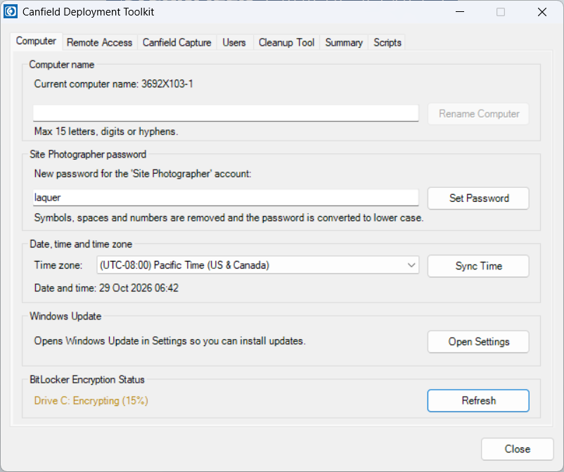
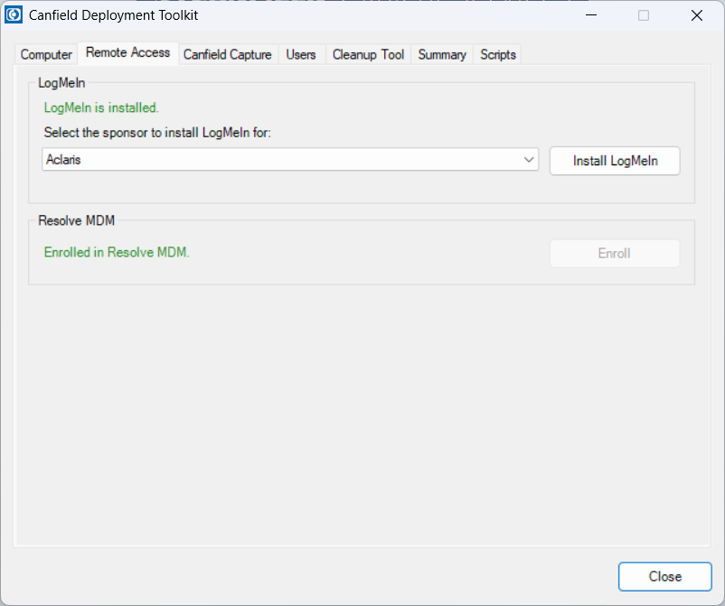
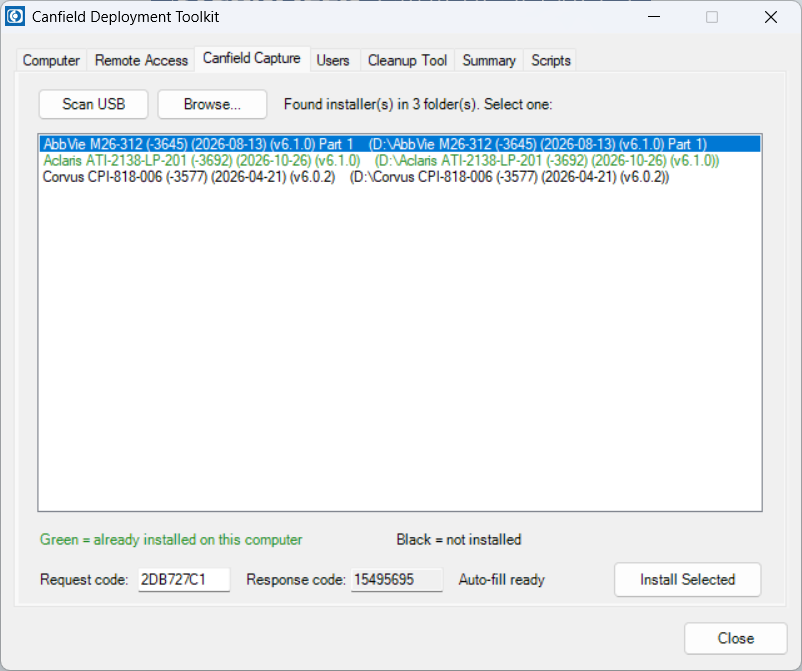
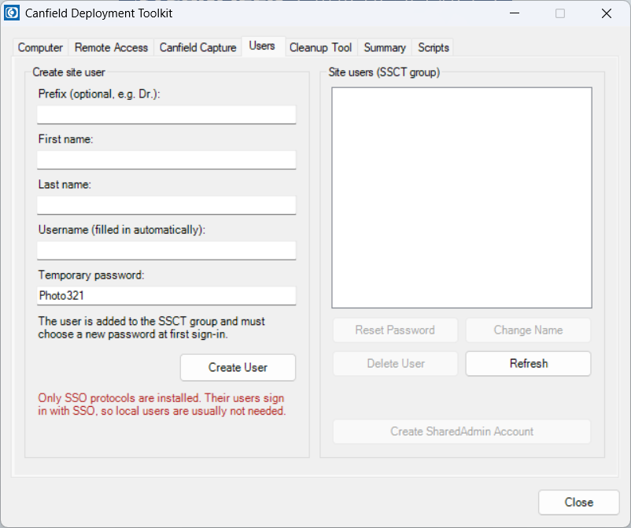
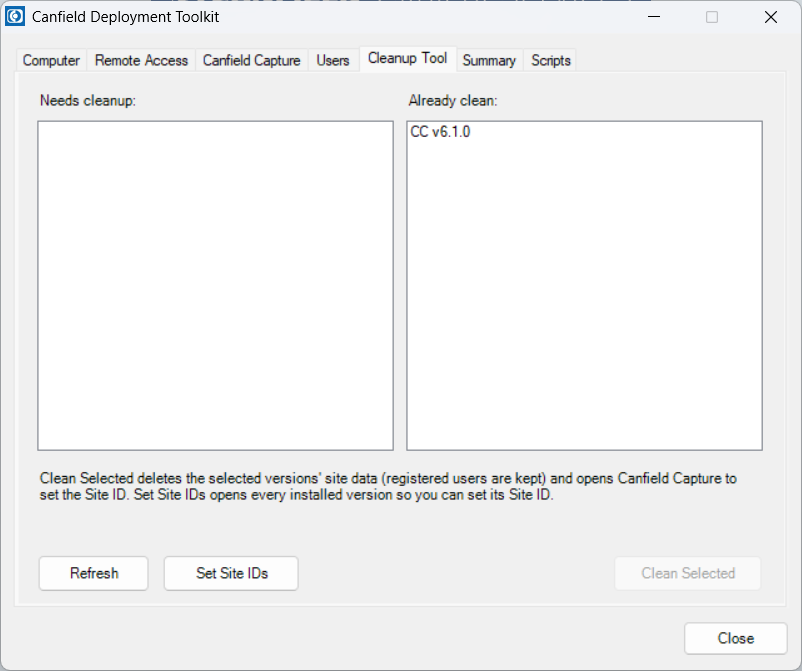
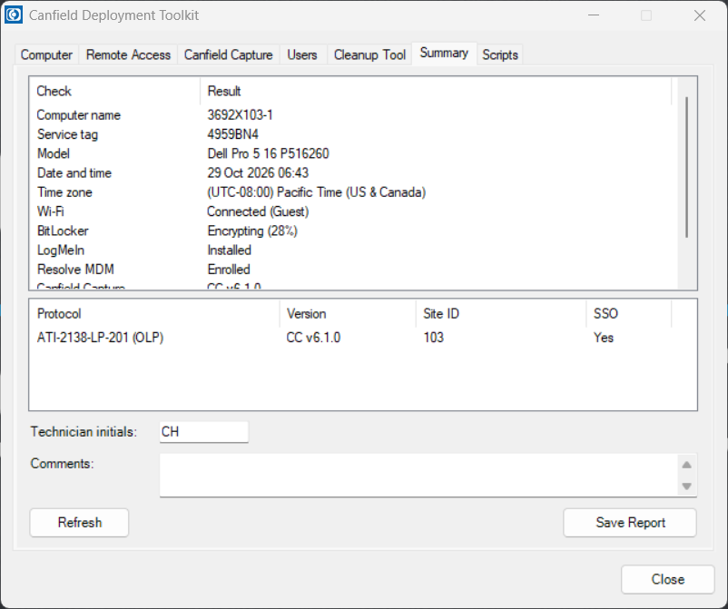
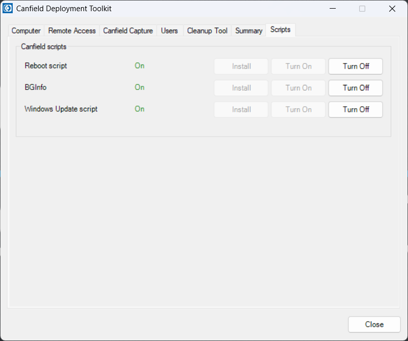

# Canfield Deployment Toolkit: User Guide

The Canfield Deployment Toolkit (`CDT.exe`) gathers the steps for setting up a
clinical study site computer into one window. Each tab handles one part of
the job. This guide explains what each tab is for and how to use it.

## Before You Start

Have these ready:

- A USB drive with the Canfield Capture installer folders (each with a `setup.exe`).
- `sponsors.csv` next to `CDT.exe`, for installing LogMeIn.
- The `Scripts` folder next to `CDT.exe`, for the Canfield scripts and Resolve MDM.
- A network connection (LogMeIn is downloaded during install).

Double-click `CDT.exe` and click **Yes** when Windows asks for administrator
rights.

### Suggested Order

Work through the tabs from left to right, and finish on **Summary** to save
the QC report. The **Scripts** tab can be done at any point.

## Computer Tab

Basic computer settings.

- **Rename Computer**: type the new name (up to 15 letters, digits or
  hyphens) and click **Rename Computer**. The toolkit offers to restart,
  which is needed for the new name to take effect.
- **Site Photographer password**: type the password and click
  **Set Password**. Symbols, spaces and numbers are removed and letters are
  made lower case. The password never expires.
- **Time zone**: pick the site's time zone from the list. It applies right
  away. Click **Sync Time** to set the clock from the internet time server.
- **Windows Update**: **Open Settings** opens Windows Update so you can
  install updates.
- **BitLocker**: shows whether the system drive is encrypted. Green means
  encrypted, amber means encryption is in progress, and red means not
  encrypted or no recovery key.

## Remote Access Tab

Sets up remote support.

- **LogMeIn**: choose the study sponsor and click **Install LogMeIn**. The
  toolkit downloads and installs LogMeIn into that sponsor's account. If
  LogMeIn is already installed, it asks before reinstalling.
- **Resolve MDM**: click **Enroll** to enroll the computer in device
  management. The status line shows whether it is already enrolled.

## Canfield Capture Tab

Installs Canfield Capture and provides a PowerShell implementation of the Response Code Generator
for registering users.

1. Insert the USB drive. The toolkit scans it the first time you open the
   tab. Click **Scan USB** to scan again. If the installer is somewhere
   else (another folder, a network share) or the scan finds nothing, click
   **Browse...** and pick its `setup.exe`.
2. Pick an installer from the list. Versions already installed on this
   computer show in **green**; versions not yet installed show in black.
3. Click **Install Selected**. The installer runs silently and the toolkit
   reports when it is done or if a restart is needed.

**Request / Response Codes.** The toolkit calculates the response code from
the request code exactly as ResponseCodeGenerator.exe does, so RCG is
no longer required. Make sure the toolkit is open when registering users and
the request/response codes will populate automatically just like RCG.
There is a status indicator next to the **Response code:** field that indicates
whether auto-fill is functioning properly.

## Users Tab

Manages the Windows accounts that site staff sign in with.

- **Create site user**: enter first and last name (and a prefix if
  needed). The username fills in automatically and can be edited. The
  temporary password is `Photo321`; the user must choose a new one at first
  sign-in.
- If every installed protocol uses single sign-on (SSO), a red note under
  **Create User** says so, since local users are usually not needed.
- Select a user in the list to **Reset Password**, **Change Name** or
  **Delete User**. Built-in accounts (Site Photographer, SharedAdmin,
  Administrator, and the signed-in account) cannot be deleted.
- **Create SharedAdmin Account** asks for a password and creates the shared
  administrator account.

## Cleanup Tool Tab

Removes leftover site data from Canfield Capture so the computer is ready for
a new site.

- Versions that still have site data are listed under **Needs cleanup** and
  are already ticked. Click **Clean Selected** and confirm.
- After cleaning, Canfield Capture opens for each cleaned version. Set the
  Site ID, then close Capture to move on to the next one.
- Finally, all site users are set to change their password at next sign-in.
- **Set Site IDs** opens every installed version in turn, so you can set the
  Site ID without cleaning.

Registered users are always kept. Cleanup never deletes them.

## Summary Tab

A final check of the whole setup, and the QC report.

1. Review the list: computer name, service tag, time zone, Wi-Fi, BitLocker,
   LogMeIn, Resolve MDM, Canfield Capture versions, site users, and each
   protocol's Site ID.
2. Enter your initials and any comments.
3. Click **Save Report**. It saves a picture of the window (JPG) and a text
   file with the same details.

## Scripts Tab

Turns the Canfield scheduled scripts on or off.

For the Reboot script, BGInfo and the Windows Update script, the tab shows
**On**, **Off** or **Not installed**. Use **Install**, **Turn On** or
**Turn Off** as needed. Buttons are greyed out if the `Scripts` folder is
missing.

## Common Problems

| Problem | What to do |
|---|---|
| No sponsors in the LogMeIn list | Put `sponsors.csv` next to `CDT.exe` and restart the toolkit. |
| Script or Resolve MDM buttons are greyed out | Put the `Scripts` folder next to `CDT.exe`. |
| "No installer found on the USB drive" | Check the drive has folders containing `setup.exe` and click **Scan USB**, or click **Browse...** and pick the `setup.exe`. |
| Canfield Capture install reports an error code | Run that installer's `setup.exe` from the USB drive by hand. |
| Request code does not fill in | Type the request code from Capture into the **Request code** box. |
| Summary shows a Site ID as "Not set" | Use **Set Site IDs** on the Cleanup Tool tab. |
